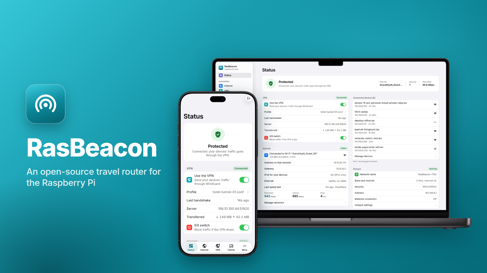

<p align="center"></p>

<p align="center">
  <a href="https://github.com/aazam476/RasBeacon/stargazers"></a>
  <a href="https://github.com/aazam476/RasBeacon/releases/latest"></a>
  <a href="https://github.com/aazam476/RasBeacon/commits/main"></a>
  <a href="https://github.com/aazam476/RasBeacon/actions/workflows/ci.yml"></a>
  
  <a href="LICENSE"></a>
</p>

<h1 align="center">RasBeacon</h1>

An open-source Wi-Fi travel router for the Raspberry Pi.
Your devices join RasBeacon's hotspot, and RasBeacon joins the network where
you are (a hotel, a café, a campus or an office). The goal is that all your traffic can
go through your own WireGuard VPN, with a kill switch and an easy way through
hotel login pages.

- **Setup happens in your phone's browser.** No command line, no compiling.
- **No shared default passwords.** Every device generates its own on first
  boot.
- **No telemetry and no cloud.** Everything works offline, and nothing
  about you or your devices is sent anywhere. What RasBeacon itself
  contacts on the internet:
  - the speed test, only when you press its button (like Cloudflare's own
    speed test page, it sends its result to Cloudflare);
  - Google's and Apple's "is there internet?" addresses, every 10 minutes
    (more often while the VPN can't connect), to notice a hotel's login
    page, as phones do;
  - the time: NTP, or Google, Apple and Cloudflare over HTTPS where NTP is
    blocked;
  - GitHub, once a day while plugins from the catalog are installed (to
    offer their updates), and for new RasBeacon versions only if you
    choose a schedule on the System page.
- **Licensed under Apache-2.0.**

> **Status: beta (v0.2). Everything is built and tested in CI; hardware
> testing is in progress** (see the [full test plan](docs/testing/full.md)). RasBeacon
> runs your hotspot (plus an optional guest network), connects it to the
> internet through Ethernet or Wi-Fi (open, password, or WPA-Enterprise
> networks such as eduroam, [guide](docs/wpa-enterprise.md)), can send everything through
> your own WireGuard VPN with a kill switch, keeping several VPN profiles
> ([server guide](docs/wireguard-server.md)), lets you log in to hotel login
> pages without anything leaving the VPN, and installs signed updates with
> automatic rollback. Its settings pages, designed like Apple's Settings
> app, also show live traffic and hardware readings, let you pause or
> disconnect single devices, and run Cloudflare's speed test when you ask.

## What you need

| Part | Notes |
|---|---|
| A Raspberry Pi: **4 or 5** (recommended), or **Zero 2 W, 3B or 3B+** (best effort) | The Pi 4 and 5 get everything, including updates installed from the System page; they are tested before each release. A Pi 4 may need a one-time bootloader update first (see [Troubleshooting](#troubleshooting): 4 short flashes). The Zero 2 W, 3B and 3B+ share a second image with the same features, except that new versions are flashed instead of installed (and the Zero 2 W has no Ethernet port); they are tested when someone can. Older and 32-bit boards don't work. See [docs/compatibility.md](docs/compatibility.md). |
| A USB Wi-Fi adapter that can run a hotspot | Recommended: one with a **MediaTek MT7612U** chip (e.g. Alfa AWUS036ACM). A TP-Link Archer T3U also works in principle. The Pi's built-in Wi-Fi alone holds only about 8 devices. |
| microSD card, 8 GB or larger | |
| A 5 V / 3 A USB-C power supply | Or a USB power bank, if you want to use it away from an outlet |

## Set up (about 15 minutes)

1. **Download** `rasbeacon-<version>.img.xz` from the
   [Releases](../../releases) page: one image for the Pi 4, 400, 5 and 500.
   For a Pi Zero 2 W, 3B or 3B+, download `rasbeacon-pi3-zero2w-<version>.img.xz`
   instead (its card drive is called `BOOT` rather than `BOOTCONFIG`). Also download `SHA256SUMS` if you want to
   check the file (see [Checking your download](#checking-your-download)).
2. **Flash** it with [Raspberry Pi Imager](https://www.raspberrypi.com/software/):
   1. Choose your device.
   2. Under *Operating System*, pick **Use custom** and select the downloaded
      file.
   3. Choose your SD card.
   4. When asked about OS customisation, choose **No**: RasBeacon is set up
      from your phone instead.

   [balenaEtcher](https://etcher.balena.io/) works too.
3. **Optional, recommended in crowded places:** after flashing, the card
   shows up on your computer as a small drive called `BOOTCONFIG`. Create a
   plain text file named `setup.txt` on it containing:
   ```
   setup_password=choose-a-password
   ```
   (8 to 63 characters.) The setup network will then use this password
   instead of being open.
4. **Assemble:** put the card in the Pi, plug the USB Wi-Fi adapter into a
   USB port, then connect power. The first boot takes about a minute.
5. **Join the setup network** from your phone. It is called
   `RasBeacon-Setup-XXXX`, where XXXX is unique to your device. Your phone
   should open the setup page by itself. If it doesn't, open
   `http://10.87.0.1` in the browser.
6. **Finish setup:**
   1. Choose an admin password (for these settings).
   2. Choose your hotspot's name and Wi-Fi password (a random one is
      suggested).
   3. Choose the band: 2.4 GHz works with every device; 5 GHz is faster but
      has shorter range.
   4. Say where you'll use it (traveling or at home), so the page shows
      the right next step.
7. After a few seconds the setup network disappears and **your hotspot
   starts**. Join it, then open `http://10.87.0.1` (or
   `http://rasbeacon.lan`) to see the status page.
8. **Connect RasBeacon to the internet:** plug in an Ethernet cable, or open
   the **Internet** page, tap *Look for nearby networks*, pick the network,
   enter its password, *Add to list*, and *Save*. You can save several
   networks; RasBeacon joins the first one in the list that is in range,
   and prefers a plugged-in cable.
9. **Optional, your VPN:** on the **VPN** page, import your WireGuard
   `.conf` file; the VPN turns on by itself. Keep the *Kill switch* on so
   nothing is ever sent outside the VPN: while it is on, turning the VPN
   off leaves your devices with no internet at all (the page warns you).
   You can import several files, rename them, and pick the one in use.

> **Important:** the setup network closes after 30 minutes if nobody
> finishes setup. Unplug and replug the power to reopen it. Until setup is
> done, whoever finishes it first owns the device, which is why `setup.txt`
> is recommended in busy places.

## Troubleshooting

| What you see | What it means and what to do |
|---|---|
| No `RasBeacon-Setup-…` network after 2 minutes, and the green LED blinks **3 short, 1 long**, repeating | `setup.txt` exists but can't be used. Common causes: the password is shorter than 8 or longer than 63 characters, or has accented letters or emoji; the line doesn't start with `setup_password=`; or there is something else in the file. Fix or delete the file on the `BOOTCONFIG` drive and power-cycle. |
| No setup network, and the green LED repeats **4 short flashes** | The Pi 4's bootloader (firmware stored on the board) is too old to start RasBeacon's A/B layout. Update it once: in Raspberry Pi Imager choose your Pi 4, then *OS → Misc utility images → Bootloader → SD Card Boot*, write it to any SD card, boot the Pi with it until the green LED blinks steadily (green screen on a monitor), then reflash RasBeacon. Pi 5s ship with a new enough bootloader. |
| No setup network, and another repeating pattern of long/short flashes | A boot error. Count the long and short flashes and look them up in the [Raspberry Pi LED code table](https://www.raspberrypi.com/documentation/computers/configuration.html#led-warning-flash-codes). |
| No setup network and no blinking | Check the USB Wi-Fi adapter is plugged in, and power-cycle. If it still doesn't appear, connect the Pi to a TV and keyboard, or see the [test plan](docs/testing/full.md#17-if-something-fails-what-to-send) for how to collect logs. |
| Devices on the hotspot say "No internet" | Check the **Internet** section of the Status page. "Not connected": plug in a cable or save a Wi-Fi network on the Internet page. Wi-Fi "Looking for your saved networks": the network is out of range or its password is wrong. If the network shows a login page (hotels), see the next row. |
| Hotel or café Wi-Fi with a login page | Your phone should show RasBeacon's *This network needs a login* page by itself (or open `http://10.87.0.1/#/portal`). Tap **Open the login page here**: RasBeacon opens the hotel's page itself and shows it to you; tap and type on it as usual. Nothing from your devices leaves the VPN, and it closes by itself once you're logged in. If a page doesn't work that way, **Start login mode** instead: for at most 10 minutes (extendable to 30), web traffic from your devices skips the VPN so they can reach the page directly. |
| A warning says the Ethernet port "seems to be plugged into a network" | The port is set to *Client port* (for your own laptop), but it's plugged into a network. Set it to *Uplink* on the Internet page if that cable is your internet connection. |
| The status page warns that the built-in Wi-Fi is running the hotspot | RasBeacon didn't find a USB adapter it can use. Plug one in and choose *Reboot* on the System page. |
| Nothing works and you want to see why | Put the SD card in a computer and create an empty file named `debug` on the `BOOTCONFIG` drive. Boot the Pi and wait 3 minutes, then unplug it. Back on the computer, open `rasbeacon-debug.txt` from the same drive. It holds the startup logs: no passwords (RasBeacon keeps them out of its logs, plugins' included), but device names and MAC addresses, so delete it afterwards. |
| Want a new admin password | System → **Change admin password**, with the current one. Other devices are logged out. |
| Forgot the admin password | Factory reset: put the SD card in a computer and create an empty file named `factory-reset` on the `BOOTCONFIG` drive. At the next start, RasBeacon erases all settings and runs first-time setup again. (Or hold the optional reset button for 10 seconds.) |
| An update didn't install | The System page says why. "not signed by a key this RasBeacon trusts": use update files from the official Releases page; images built before signing was set up can't install updates, so flash the new image once. "for rpi64, but this is a pi4": the device runs an image from before the Pi 4 and Pi 5 shared one; flash the new image once. "older than the version running": RasBeacon doesn't go back to older versions. "needs a fresh install" (or "can't be installed over"): that version changed too much to install over yours; follow [the steps below](#updating). |

## Checking your download

Each release lists the SHA-256 checksum of every image in `SHA256SUMS`.

- **macOS/Linux:** `shasum -a 256 rasbeacon-v0.1.0.img.xz`
- **Windows PowerShell:** `Get-FileHash rasbeacon-v0.1.0.img.xz`

The result must match the line in `SHA256SUMS`.

## Updating

Download the release's `rasbeacon-<version>.rbupdate` file (on any phone or
computer), then on RasBeacon's **System** page choose it and tap **Install
update**. RasBeacon itself doesn't need to be online for this. It checks
that the file was signed by the RasBeacon release key, installs it next to
the running version, and restarts into it. If the new version doesn't start
correctly, it goes back to the old one by itself. Your settings are kept.

RasBeacon can also look for new versions on GitHub by itself (every hour,
6 hours, day or week; off by default) and tell your phone: enter an
[ntfy](https://ntfy.sh) topic, or a Discord, Gotify or Home Assistant
webhook, on the System page.

RasBeacon never installs an older version than the one it runs. And
sometimes a new version changes too much to be installed over an old one:
then the System page says it **needs a fresh install** and walks you
through it. Back up your settings there, flash the new image (the
`.img.xz` file) onto the SD card, set RasBeacon up, and restore the backup
on the System page. The Pi Zero 2 W, 3B and 3B+ always update this way,
since their image has one copy of the system.

## Optional extras

- **Guest network** for visitors: the **Guests** page. Guests get the
  internet (through your VPN, if it is on) but can't reach your devices,
  each other, or the settings. It needs a USB adapter that can broadcast
  two networks at once (MediaTek MT7612U adapters can; the page tells you
  if yours can't).
- **Metered connection** (on a phone's hotspot or a paid plan): tick it on
  the **Hotspot** page. Android devices then hold back big downloads; on
  iPhones and Macs turn on *Low Data Mode* for the hotspot in Wi-Fi
  settings, and on Windows set it as a metered connection.
- **Who can join:** on the **Hotspot** page, let only the devices you list
  join (by MAC address; phones often use a private one per network), and
  set the most devices at once. Devices on Ethernet always get in.
- **WPA3 only** for the hotspot, if all your devices support it: the
  **Hotspot** page.
- **Public IPv6 through the VPN:** if your WireGuard server routes a public
  IPv6 /64 to RasBeacon, enter it on the **VPN** page (under *Server
  details*); devices then get their own public IPv6 addresses.
- **HTTPS** for the settings pages: the **HTTPS** page. Your browser warns
  about RasBeacon's own certificate the first time; compare the
  fingerprint shown on that page.
- **Plugins:** the **Plugins** page adds features like ad blocking (AdGuard
  Home), file sharing (Samba) or the Argon ONE V2 case's fan. Each runs on
  its own with only the permissions you allow, and reaches the internet
  through the VPN. See [docs/plugins.md](docs/plugins.md).
- **Your own DNS servers**, also through the VPN: the **Internet** page.
- **Share the Wi-Fi with a QR code:** the **Hotspot** and **Guests** pages.
- **Name your devices, see their data use** and set a data limit per
  device: the **Clients** page.
- **More wired devices:** plug a USB Ethernet adapter into RasBeacon and
  it becomes a port of your hotspot (with the same check as the client
  port: a cable that leads to another network is never connected), so the
  Ethernet port can carry the internet at the same time.
- **Fixed addresses and port forwarding:** give a device the same address
  every time (the **Clients** page), and let the internet reach a game
  server, a camera or a plugin through a port (Internet → **Port
  forwarding**). This works where the network gives RasBeacon a public
  address or forwards the ports to it, such as at home; hotel and phone
  networks usually don't, and the page says so. If your VPN routes a public
  IPv6 network to RasBeacon, a rule can also open the port on the device's
  own IPv6 address.
- **Backups:** the **System** page saves every setting and the plugins in
  a password-encrypted file, to restore or move to another RasBeacon. You
  choose whether it also keeps the plugins' data, and their apps (so a
  restore works offline); otherwise they are downloaded again.
- **Rename RasBeacon** (then reach it at `<name>.lan`) and **shut it down**:
  the **System** page.
- **SSH** for advanced users: the **SSH** page (keys only, hotspot side
  only).
- **Factory-reset button:** connect a push button between pin 11 (GPIO 17)
  and pin 9 (ground). Holding it for 10 seconds erases all settings.

## For contributors

- **How it's built:** [CONTRIBUTING.md](CONTRIBUTING.md) covers building,
  testing, running a simulated device on your computer, and code style.
- **How it works:** [docs/architecture.md](docs/architecture.md), with a
  [glossary](docs/glossary.md) of networking terms.
- **Design and decisions:** [docs/design.md](docs/design.md) and
  [docs/decisions/](docs/decisions/).
- **Web UI and API:** [docs/api.md](docs/api.md) and
  [docs/ui-contract.md](docs/ui-contract.md).
- **Releases and update signing:** [docs/releasing.md](docs/releasing.md).
- **Security problems:** please report them privately, see
  [SECURITY.md](SECURITY.md).

## License

Apache-2.0, see [LICENSE](LICENSE). The images also contain Debian and
Raspberry Pi OS packages under their own licenses (GPL, LGPL, MIT and others)
and binary Wi-Fi firmware. See
[LICENSES/THIRD_PARTY.md](LICENSES/THIRD_PARTY.md) and, for getting their
source code, [docs/source-code.md](docs/source-code.md).
